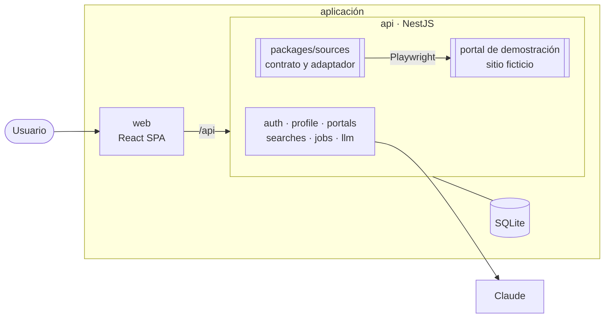

# Job Finder (demostración)

[](https://github.com/EmoMeza/job-finder-showcase/actions/workflows/ci.yml)

Aplicación web full-stack que **lee un portal de empleo con la cuenta del usuario, guarda las
ofertas y arma un perfil profesional a partir del CV con ayuda de IA**. Este repositorio existe
para mostrar cómo está construida: las tecnologías, las decisiones y la forma de automatizar un
sitio web con cuidado.

## De dónde viene

Estas piezas vienen de un proyecto personal para automatizar la búsqueda de empleo. Ese proyecto
**se detuvo antes de terminarse**: dependía de leer plataformas de terceros de forma automatizada
con la cuenta del usuario, y eso no es compatible con los términos de uso de esas plataformas.

Lo que quedó construido se conserva aquí, con un cambio: en vez de plataformas reales, la
aplicación trabaja contra un **portal de empleo ficticio incluido en el código**
([docs/portal-demo.md](./docs/portal-demo.md)). Sus ofertas y empresas son inventadas. El
repositorio no accede a ningún sitio de terceros ni está pensado para hacerlo.

## Qué muestra

| Tema                         | Qué hay                                                                                                                                           | Dónde mirar                                                                                               |
| ---------------------------- | ------------------------------------------------------------------------------------------------------------------------------------------------- | --------------------------------------------------------------------------------------------------------- |
| Automatización de navegador  | Un Chromium sin ventana abre el portal con la sesión del usuario, lee su feed por tandas y el detalle de cada oferta                              | [`packages/sources/src/demo`](./packages/sources/src/demo)                                                |
| Automatizar sin dejar huella | El adaptador usa solo las consultas que hace la propia página e intercepta la que podría modificar la cuenta                                      | [ADR 0013](./docs/adr/0013-leer-sin-dejar-huella.md)                                                      |
| Tareas en segundo plano      | Búsquedas manuales o periódicas con avance en vivo, historial, y captura y HTML de la página cuando algo falla                                    | [`apps/api/src/searches`](./apps/api/src/searches)                                                        |
| Sesiones de terceros         | La cuenta del portal se conecta con un enlace de un solo uso; la sesión se guarda cifrada (AES-256-GCM) y nunca sale de la API                    | [ADR 0012](./docs/adr/0012-conexion-de-cuentas-de-portales.md)                                            |
| Autenticación                | Sesiones en base de datos con cookie httpOnly, argon2id, límite de intentos y CLI de usuarios                                                     | [ADR 0009](./docs/adr/0009-sesiones-no-jwt.md)                                                            |
| IA con salida estructurada   | Un wizard arma el perfil desde el CV: la IA prellena, la persona revisa paso a paso. El proveedor (línea de comandos o API) lo elige cada usuario | [ADR 0006](./docs/adr/0006-proveedores-ia.md), [0011](./docs/adr/0011-perfil-estructurado-desde-el-cv.md) |
| Frontend                     | React con rutas protegidas, formularios validados con el mismo esquema que el backend y un sistema visual propio                                  | [docs/diseno.md](./docs/diseno.md)                                                                        |
| Pruebas                      | 224 tests; los de automatización corren con un navegador real contra el portal ficticio                                                           | `pnpm test`                                                                                               |
| Operación                    | Docker Compose, GitHub Actions (formato, lint, tipos, tests, imágenes, escaneo de secretos) y decisiones registradas como ADR                     | [docs/adr](./docs/adr)                                                                                    |

Lo que el proyecto original planeaba y **no se construyó**: evaluar las ofertas con IA contra el
perfil, postular de forma asistida, hacer seguimiento de las postulaciones y estadísticas.

## Arquitectura



- El portal se lee a través de un **adaptador** (`packages/sources`) que implementa un contrato
  común: cómo se conecta la cuenta, de dónde salen las condiciones de búsqueda y cómo se leen las
  ofertas. La API no sabe nada del portal fuera de ese contrato.
- **Leer no modifica la cuenta del usuario.** En el portal de demostración, pedir más ofertas
  guarda como preferencias los filtros enviados; el adaptador deja que esa consulta la haga la
  propia página y la bloquea si no lleva exactamente lo que ya estaba guardado.
- Las ofertas son globales y el estado de cada una es por usuario.

Más detalle en [docs/arquitectura.md](./docs/arquitectura.md).

## Stack

| Capa           | Tecnología                                                 |
| -------------- | ---------------------------------------------------------- |
| Backend        | NestJS 12, TypeScript, zod                                 |
| Frontend       | React 19, Vite, React Router, TanStack Query, Tailwind CSS |
| Base de datos  | SQLite + Drizzle ORM                                       |
| Automatización | Playwright                                                 |
| IA             | Claude (CLI `claude -p` o Anthropic SDK)                   |
| Tooling        | pnpm workspaces, oxlint, Prettier, Vitest                  |
| Infra          | Docker Compose, GitHub Actions                             |

## Estructura

```
├── apps/
│   ├── api/          NestJS: API REST, tareas programadas, navegador, IA
│   └── web/          React SPA
├── packages/
│   ├── shared/       tipos y esquemas compartidos entre front y back
│   └── sources/      contrato de los adaptadores, adaptador y portal de demostración
└── docs/             arquitectura, decisiones (ADR) y sistema visual
```

## Probarlo

Requisitos: Node 22+ y pnpm 11 (`npm install -g pnpm`).

```bash
pnpm install
pnpm playwright:install      # Chromium para la automatización, una sola vez
cp .env.example .env
# En .env: APP_SECRET=<salida de `openssl rand -base64 32`>
pnpm build
pnpm cli user:create --email tu@email.com --name "Tu nombre"
pnpm dev                     # web en :5173, API en :3000, portal de demostración en :4100
```

Recorrido de la demostración:

1. Entra a `http://localhost:5173` con el usuario que creaste.
2. En **Configuración → Portales**, abre Empleos Demo, pide un enlace de ingreso, cópialo sin
   abrirlo y pégalo en la app. El servidor lo abre en su propio navegador y guarda la sesión.
3. En **Búsquedas**, aprieta "Buscar ahora". Verás el avance, las condiciones leídas del portal y
   el historial.
4. En **Ofertas** queda lo encontrado.
5. En **Mi perfil** puedes subir un CV en PDF; esa parte necesita un proveedor de IA configurado
   en **Configuración**.

| Comando                                                     | Qué hace                                     |
| ----------------------------------------------------------- | -------------------------------------------- |
| `pnpm dev`                                                  | Levanta API, web y portal de demostración    |
| `pnpm build`                                                | Compila todos los paquetes                   |
| `pnpm test`                                                 | Tests (Vitest) de todos los paquetes         |
| `pnpm typecheck`                                            | Chequeo de tipos                             |
| `pnpm lint`                                                 | oxlint                                       |
| `pnpm format`                                               | Prettier                                     |
| `pnpm cli <comando>`                                        | CLI de administración de usuarios            |
| `pnpm --filter @job-finder/api db:generate --name <nombre>` | Genera una migración a partir de `schema.ts` |

También corre con Docker: `docker compose up -d --build` publica la web en `127.0.0.1:8080` y el
portal de demostración en `127.0.0.1:4100`. Los usuarios se crean con
`docker compose exec api node dist/cli.js user:create --email ... --name ...`.

### Proveedor de IA

Cada usuario elige en **Configuración** cómo se usa Claude:

- **Línea de comandos:** usa una suscripción de Claude configurada en el servidor. En local
  funciona con la sesión de `claude` de tu máquina; en Docker, con `CLAUDE_CODE_OAUTH_TOKEN`.
- **API de Anthropic:** cada usuario ingresa su API key, que se guarda cifrada y nunca se vuelve
  a mostrar completa.

## Calidad

Cada push y PR pasa por GitHub Actions: formato, lint, build, typecheck, tests, build de imágenes
Docker y escaneo de secretos con gitleaks. El flujo de trabajo está en
[CONTRIBUTING.md](./CONTRIBUTING.md).

## Alcance y uso

Este repositorio es una demostración técnica. Automatizar el acceso a un sitio web puede estar
prohibido por sus términos de uso: por eso aquí todo corre contra el portal ficticio incluido, y
el código no debe apuntarse a sitios de terceros.
